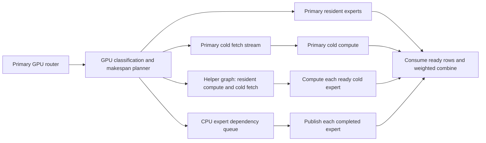

# Opt-in CUDA expert scheduling on two GPUs and a CPU

This fork preserves the measured RTX 5080 + RTX 2070 + i7-9700K decode path on
top of upstream `1aff6d14117b88171fcfcec8f2b55fdc47f2b165` (engine 0.1.50).
The new options are disabled by default. This is an engine optimization, not a
new model, a default configuration change, or a claim of universal 100 token/s.

## Execution and ownership

The primary GPU classifies and groups the routed experts, then publishes one
immutable task packet per layer in mapped host memory. A helper CUDA Graph reads
those packets; the host launches it once per verification window. The CPU pool
consumes only its grouped fallback jobs. The CPU still coordinates windows,
cache maintenance and cancellation; this is not a CPU-free engine.



The transfer path uses mapped host memory. It does not assume CUDA peer access
between consumer GPUs. Producers flush their own result rows before publishing
completion. The verifier retains a final host bookkeeping barrier before input
buffers can be reused. Auxiliary streams are drained before shared buffers are
freed, including after an aborted window.

`STRATA_SCHED_THREEWAY=2` estimates the **whole layer's** completion time, including
primary/helper cold reads, resident work, CPU service, return traffic and shared
RAM contention. Two bounded greedy sweeps consider high-reuse experts first and
then revisit helper-resident work. This is a cost heuristic, not an exhaustive
optimal solver. Bandwidth and service constants must be calibrated on the target
machine; independent RAM bandwidths must not be added together.

CPU gate/up, intermediate quantization and down work form per-expert dependencies.
Ready bitsets replace repeated full expert scans. The final down partition
publishes that expert's rows without waiting for unrelated CPU experts. Optional
reference checks write to private buffers, never to already published outputs.

## Three different kinds of storage

1. Primary and helper hot caches hold disjoint experts. With
   `STRATA_ADAPT_DISTINCT_BYTES=1`, adaptation counts an expert once per window
   and ranks promotion gains by saved weight bytes. Helper replacements happen
   only at drained primary adaptation boundaries and exclude primary residency
   and pending promotions. The next window refreshes the helper address table.
2. `STRATA_PRIMARY_REUSE_SLOTS=2` adds two temporary slots **per layer**. Only
   experts already assigned to the primary cold-copy queue are admitted; there
   is no speculative weight traffic. Current hits cannot be evicted, tags are
   published after copying, and admission prefers more token-row reuse. Helper
   ownership and the existing tail-skip eligibility take precedence over reuse.
3. Windows CUDA 13 host VMM maps the RAM arena on the primary GPU and grants the
   helper bounded read access to selected allocations. This is mapped system
   RAM, not extra VRAM. The helper's unmapped misses remain eligible for the CPU
   or primary GPU. DMA refills respect allocation boundaries with different
   helper access permissions.

The measured two-slot allocation was 187.35 MiB (96 temporary experts). Filling
all helper VRAM is not the objective; lower layer completion time is.

## Supported opt-in setup

The combined GPU task path requires CUDA, one helper, warm native expert weights,
embedding width 2560, top-k 10, verification windows of 1–8 tokens, unsplit
windows, separate result readiness, and copy-kernel PCIe transfers. It rejects
Hadamard layers, peer/foresight paths, resident-only device plans, batch/split
windows and incompatible balancing. Host VMM and the selected conditional cold
graph path require **Windows and CUDA 13** plus driver support.

The path-free [measured preset](examples/dual-gpu-moe-5080-2070.json) records the
environment and relevant engine/request options. It is a reference document,
not a launch configuration accepted directly by `strata`. Set its environment
before launching the engine, translate `engine_options` to the corresponding
hyphenated CLI arguments, and supply your own pack, GGUF, MTP, tokenizer and
expert-profile paths. The initial expert ranking is model/workload dependent;
the local measured profile and prompt are not bundled here.

| Options | Purpose |
| --- | --- |
| `STRATA_GPU_TASKS=1`, `STRATA_REMOTE_DIRECT_IO=1`, `STRATA_REMOTE_DIRECT_INPUT=1`, `STRATA_REMOTE_SEPARATE_READY=1` | Device task table and producer-owned results |
| `STRATA_GPU_FETCH_OVERLAP=1`, `STRATA_GPU_FETCH_PRIORITY=1`, `STRATA_GPU_FETCH_BLOCKS=64` | Overlap primary fetch with resident work; preserve node priority in captured graphs |
| `STRATA_REMOTE_COLD_CAP=4`, `STRATA_REMOTE_COLD_CONDITIONAL=2`, `STRATA_REMOTE_EARLY_PUBLISH=1` | Bounded helper cold slots, skip empty work, publish completed experts early |
| `STRATA_ARENA_VMM=1`, `STRATA_ARENA_PIN_GIB=0`, `STRATA_ARENA_VMM_CHUNK_MIB=8`, `STRATA_REMOTE_COLD_MAP_GIB=8` | Full primary arena mapping and bounded helper access |
| `STRATA_CPU_EXPERT_DAG=1`, `STRATA_CPU_DAG_READY=1`, `STRATA_CPU_EXPERT_PUBLISH=1` | CPU dependency queue and early row publication |
| `STRATA_SCHED_THREEWAY=2`, `STRATA_SCHED_*` | RAM-aware scheduling with measured cost parameters |
| `STRATA_DISJOINT_ADAPT=1`, `STRATA_ADAPT_DISTINCT_BYTES=1`, `STRATA_REMOTE_CACHE_SWAPS=8` | Disjoint hot-cache maintenance at drained boundaries |
| `STRATA_PRIMARY_REUSE_SLOTS=2` | Reuse primary cold reads across windows; unset/0 disables allocation |
| `STRATA_REMOTE_GROUP_BUFFER=1`, `STRATA_REMOTE_GRAPH=1`, `STRATA_REMOTE_UNIFIED_PLAN=1`, `STRATA_REMOTE_CPU_OVERLAP=1` | Buffered/captured helper fallback and CPU submission overlap |
| `STRATA_REMOTE_KEEPALIVE=1` | One low-priority activity-triggered block; each kernel is bounded to 50 ms |
| `STRATA_IQ256_EXACT_MODE=2` | IQ3_S AVX2 singleton integer accumulation with unchanged block-order floating arithmetic |

Do not combine host VMM with pin-by-need, shared/mmap arenas, deferred registration
or a pin cap. Helper cache swaps require disjoint byte-scored asynchronous primary
adaptation in serve mode. The keepalive stops submitting after request activity
expires; it is optional and is not a clock-lock guarantee.

`STRATA_MULTIGPU_TAIL_SKIP=1` extends the existing tail policy to multi-GPU misses.
The measured preset used rank 7, as did its comparison configuration. **Tail
skipping changes model output.** The optimization does not establish general
quality parity for that policy; use rank 0 when all routed experts must execute.

## Evidence and limits

Historical matched-workload results on the machine above used Swift IQ3_S,
8202 input tokens, 2048 continuous output tokens, one request, MTP 6, int8 KV,
temperature 1, top-p 0.95, top-k 20 and seed 2026110492. Reload warmups were excluded.
Complete-answer correctness checks were run separately from fixed-length timing.

| Configuration | Runs | Aggregate decode token/s | Per-run range |
| --- | ---: | ---: | ---: |
| Single RTX 5080 | 3 | 81.67 | 76.23–90.05 |
| Previous two-GPU/CPU scheduler | 9 | 99.27 | 90.45–107.63 |
| Selected scheduler with strict two-slot reuse | 6 | 102.74 | 93.87–110.39 |

Aggregate throughput is total output tokens divided by total decode time. It
improved 25.80% over the single-GPU comparison and 3.49% over
the previous scheduler. Primary cold weight reads fell from 31.45 to 28.39 MB per
output token. Executed two-GPU cache hits increased from 88.43% to 89.76%; this
denominator excludes skipped tails and is not the older generic log hit rate.
The six-run coefficient of variation was 5.98%. The gate requiring every run
to exceed 100 token/s with CV below 5% **did not pass**. These observations are
not a confidence interval or a promise for other prompts/hardware.

Those timings belong to the selected experimental executable, SHA-256
`9860f56b4d8a997a591b578752594fb8cd9bf94372b4d9e4f586bff516f52ca6`.
This commit extracts its active code, removes unused experiments, repairs
diagnostic bookkeeping and supplies portable regression tests. Fresh build/test
results for the extracted source are recorded in the [validation note](DUAL_GPU_MOE_VALIDATION.md);
the earlier timings must not be relabeled as fresh measurements of that build.

Removed experiments include coupled MTP pipelining, all-GPU/pageable expert
execution, chunked primary fetch, helper adaptation enqueue/static modes and
the later device-ready wait bypass. No binary, model, machine-specific launch
file, raw profiler capture or private prompt is part of the source change.

## Validation commands

Configure the ordinary CUDA build with `STRATA_BUILD_TESTS=ON` and appropriate
architectures (75 and 120 for the measured pair). Then:

```text
cmake --build build --target strata gpu_task_reuse_test host_vmm_test iq_avx2_parity pool_test cpu_expert_publish_test
ctest --test-dir build -R "^(gpu_task_reuse_test|host_vmm_test|iq_avx2_parity|pool_test)$" --output-on-failure
build/gpu_task_reuse_test 1
compute-sanitizer --tool memcheck --error-exitcode 99 build/gpu_task_reuse_test 0
compute-sanitizer --tool memcheck --error-exitcode 99 build/gpu_task_reuse_test 1
```

The reuse test checks full byte patterns, repeated captured launches, protected
hits, empty copies, canaries, helper precedence and tail eligibility for 1/2/4
slots and 1 KiB/2 MiB blobs. `host_vmm_test` checks allocation lifetimes, mapped
reads, helper DMA, conflicting options and ordinary allocation fallback.

The model-dependent CPU publication test is run manually with a compatible
Swift/Qwen GGUF, using `STRATA_CPU_EXPERT_DAG=1`, `STRATA_CPU_DAG_READY=1`,
`STRATA_CPU_EXPERT_PUBLISH=1`, `STRATA_CPU_EXPERT_DAG_VERIFY=1`,
`STRATA_CPU_IQ_ALL_EXACT1=1`, `STRATA_IQ256_EXACT_MODE=2`, and
`BENCH_READY_VERIFY=1`. It checks real expert rows against a concurrent GPU
consumer, stale-generation reset and guard rows; the DAG diagnostic also checks
CPU rows bitwise against the serial implementation. Never include diagnostics
in performance measurements. HIP, SYCL and Metal validation are separate gates.
